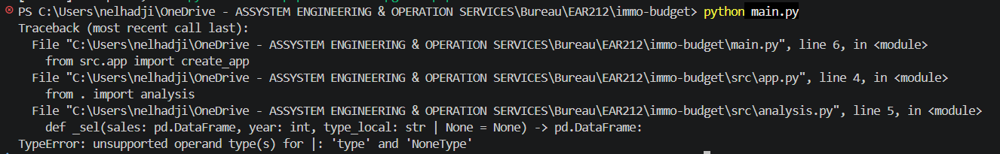
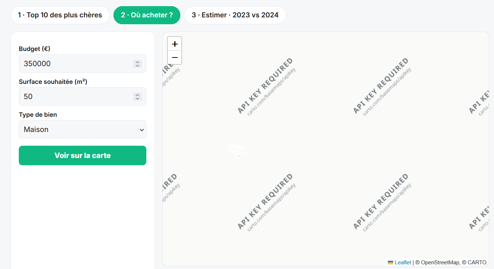
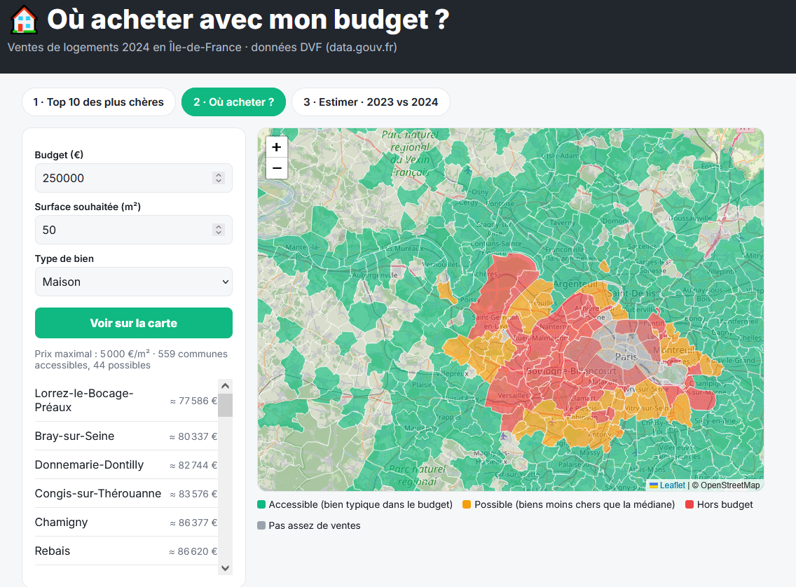
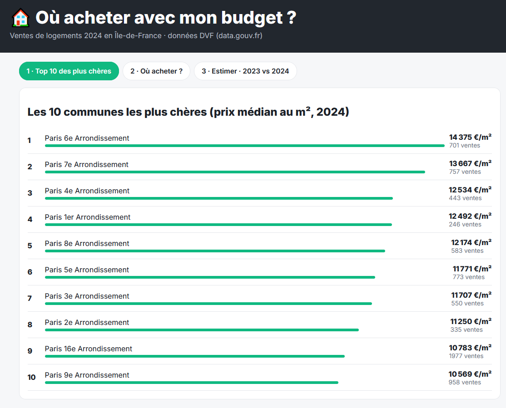
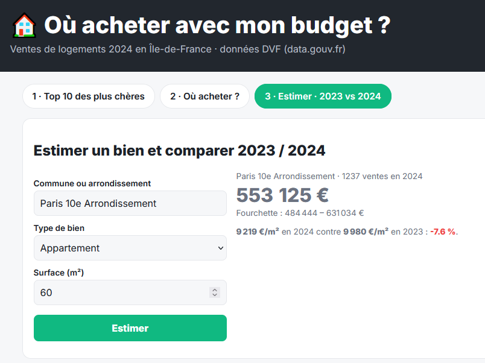

# Où acheter avec mon budget ? (Île-de-France, 2024)

## Objectif
Service web : l'utilisateur indique son **budget**, la **surface** et le **type de bien** (appartement / maison) ;
une carte colore les communes et arrondissements d'Île-de-France où l'achat est possible.
Le site comporte trois onglets, qui suivent les étapes du sujet :
1. le **top 10** des communes les plus chères (prix médian au m², 2024) ;
2. le **service** « Où acheter ? » et sa carte ;
3. l'**estimation** d'un bien (avec fourchette de prix) et la comparaison **2023 / 2024**.

Données : ventes de logements DVF (data.gouv.fr) et contours des communes et arrondissements (geo.api.gouv.fr).

## Installation
Prérequis : **Python 3.9 ou plus récent**.

```bash
pip install -r requirements.txt
```
Aucune clé d'API n'est nécessaire. Réglages facultatifs (port, seuil de ventes) : copier `.env.example` en `.env`.

## Lancement
```bash
python main.py
```
Au premier lancement, le script télécharge les fichiers DVF 2023-2024 des 8 départements d'Île-de-France
et les contours des communes dans `data/` (dossier ignoré par git, quelques minutes), puis ouvre
http://127.0.0.1:5000. Les lancements suivants sont immédiats.
`python main.py --refresh` force un nouveau téléchargement.

## Architecture
- `main.py` : point d'entrée (préparation des données, puis démarrage du serveur)
- `src/config.py` : chemins relatifs à la racine du projet et réglages lus dans `.env`
- `src/data.py` : téléchargement, nettoyage des données DVF (une vente = un `id_mutation`)
- `src/analysis.py` : top communes, recherche selon le budget, estimation, comparaison 2023 / 2024
- `src/app.py` : API Flask (`/api/top`, `/api/search`, `/api/estimate`, `/api/communes`, `/geojson`)
- `static/index.html` : interface (carte Leaflet, formulaires)
- `tests/test_analysis.py` : tests pytest (nettoyage, top, recherche, estimation, API)
- `.env.example`, `.gitignore`, `pytest.ini`, `requirements.txt` : configuration du projet

## Tests
```bash
pytest
```
Les tests utilisent de petits jeux de données fabriqués : ils ne téléchargent rien et fonctionnent hors ligne.

## Choix et limites
- **Ventes retenues** : seules les ventes (`nature_mutation = Vente`) d'**un seul logement** sont gardées.
  Une vente multi-logements ne permet pas de répartir le prix. Les ventes dont un logement est réparti
  sur plusieurs lignes sont donc aussi écartées.
- **Valeurs aberrantes** : prix au m² filtrés entre 1 000 et 30 000 €, surfaces entre 9 et 400 m² (erreurs de saisie).
- **Classement des communes sur la carte** (prix au m² médian × surface souhaitée, comparé au budget) :
  - 🟢 *Accessible* : le bien « typique » de la commune (médiane × surface) rentre dans le budget ;
  - 🟠 *Possible* : seuls les biens moins chers que la médiane rentrent (au moins 20 % des ventes 2024) ;
  - 🔴 *Hors budget* : moins de 20 % des ventes rentrent ;
  - ⚪ *Pas assez de ventes* : moins de `MIN_SALES` ventes (8 par défaut), commune non classée.
- **Estimation** : médiane du m² de la commune × surface ; fourchette = quartiles 25 % et 75 %.
  Elle ignore l'étage, l'état du bien et le quartier.
- **Maisons** : la valeur foncière peut inclure un terrain, ce qui gonfle le prix au m² bâti.
- **Fond de carte** : tuiles OpenStreetMap, adaptées à une démonstration, pas à un fort trafic.

## Utilisation de l'IA
Modèle : **Claude** (Anthropic).

**Ce qui a marché** : la structure du projet, le téléchargement et le nettoyage des données DVF, l'API Flask,
les tests pytest et l'interface web (formulaires, carte, estimation).

**Ce qu'il a fallu corriger** après mes propres essais :
1. **Erreur `TypeError` au lancement** (capture 1) : l'annotation `str | None` n'est pas acceptée par les
   versions de Python antérieures à 3.10. Correction : `from __future__ import annotations` en tête de
   `src/analysis.py`, et prérequis « Python 3.9 ou plus » indiqué dans ce README.
2. **Fond de carte inutilisable** (capture 2) : les tuiles CARTO affichaient « API KEY REQUIRED ».
   Correction : remplacement par les tuiles OpenStreetMap, sans clé.
3. **Carte entièrement verte** : une commune était colorée dès qu'une seule vente passait dans le budget,
   si bien que la légende n'était pas respectée. Correction : quatre classes (accessible, possible,
   hors budget, pas assez de ventes), décrites dans « Choix et limites ».

## Captures d'écran
Erreurs rencontrées puis corrigées :




Résultat final :




